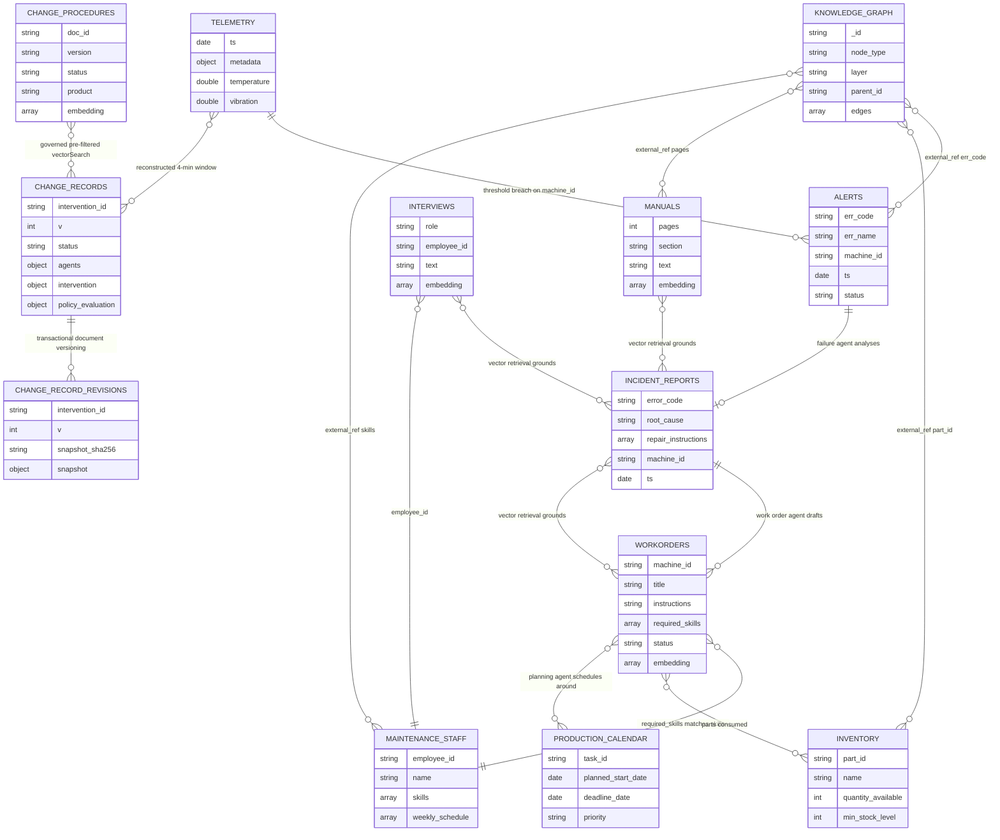

# EDD — Entity Document Diagram

MongoDB data model for the Agentic Predictive Maintenance demo.

Database: `agentic_predictive_maintenance` (configurable via `DATABASE_NAME`)

Field types below were derived from the seeded documents and the runtime writes,
not from a formal schema — except `change_records`, which enforces a strict `$jsonSchema` validator for shopfloor attribution and governance.

---

## Entity overview

| Collection | Written by | Read by | Vector index |
| --- | --- | --- | --- |
| `telemetry` | Simulator + `seed:context` (time series) | Failure agent, telemetry chart, Connected Factory Context Explorer | — |
| `alerts` | Simulator threshold check + `seed:context` | Failure agent, Alerts list, Connected Factory Context Explorer | — |
| `incident_reports` | Failure agent | Work order agent, UI | — |
| `workorders` | Work order agent + seed + `seed:context` | Planning agent, vector retrieval, Connected Factory Context Explorer | `default` |
| `manuals` | Seed / auto-sync | Failure agent (vector retrieval) | `default` |
| `interviews` | Seed / auto-sync | Failure agent (vector retrieval) | `default` |
| `inventory` | Seed / auto-sync | Work order agent | — |
| `maintenance_staff` | Seed / auto-sync | Planning agent | — |
| `production_calendar` | `generate_calendar` / release sync | Planning agent | — |
| `argument_records` | Contestable AI agents + Engineer | Contestable AI scoring & UI | — |
| `contestable_sessions` | Contestable AI API | Contestable AI UI, `$lookup` audit lineage | — |
| `materials` | Auto-init / `seed:context` | Connected Factory Context Explorer (`$lookup` limits), Agentic Audit Trail | — |
| `excursions` | Auto-init / `seed:context` | Connected Factory Context Explorer (`$vectorSearch`) | `excursion_signature_index` |
| `change_records` | Auto-init + Agentic Audit Trail API (`$jsonSchema` strict) | Agentic Audit Trail UI, Documentation Agent episodic recall | — |
| `change_record_revisions` | Auto-init + Agentic Audit Trail transactional versioning | Agentic Audit Trail `$lookup` lineage inspector | — |
| `change_procedures` | Auto-init / `seed` | Change Documentation Agent (`$vectorSearch` pre-filtered) | `change_procedures_governed_idx` |
| `knowledge_graph` | Auto-init / `seed` | Knowledge Graph explorer (`$graphLookup`), Predictive Maintenance agents (Failure, Work Order, Planning via `$graphLookup` + `$lookup`) | — |
| `checkpoints`, `checkpoint_writes` | LangGraph checkpointer | LangGraph | — |

---

## `telemetry`

Time series collection (`timeField: ts`, `metaField: metadata`, `expireAfterSeconds: 86400` — **documents self-delete after 24 hours**). Shared by the Failure Prediction simulator (`M1` temperature/vibration readings) and Connected Factory Context Explorer (`LTW-04` welding signals synced automatically to the current UTC day so readings stay within the 24-hour TTL window without accumulating).

| Field | Type | Notes |
| --- | --- | --- |
| `_id` | ObjectId | |
| `ts` | date | Time field |
| `metadata` | object | Meta field |
| `metadata.factory_id` | string | e.g. `leafy_factory` |
| `metadata.machine_id` | string | e.g. `M1` \| `LTW-04` |
| `metadata.prod_line_id` | string | e.g. `ev_module_assembly` |
| `metadata.area` | string | Optional (`welding` on `LTW-04`) |
| `metadata.signal` | string | Optional (`weld-zone-temp` \| `laser-power` \| `shield-gas-flow` on `LTW-04`) |
| `metadata.unit` | string | Optional (`degC` \| `W` \| `L/min`) |
| `metadata.workOrder` | string \| null | Optional edge-stamped MES order ID on `LTW-04` |
| `metadata.materialMaster` | string \| null | Optional ERP foil material code on `LTW-04` |
| `temperature` | double | °C (simulator readings on `M1`) |
| `vibration` | double | mm/s (simulator readings on `M1`) |
| `value` | double | Sensor measurement (`LTW-04` multi-signal telemetry) |

Indexes: `metadata_1_ts_1` (implicit), `{ "metadata.machine_id": 1, "metadata.signal": 1, ts: 1 }`, `{ "metadata.materialMaster": 1, ts: 1 }`.

## `alerts`

Shared operational alerts collection. Raised live on `M1` (`Tab Laser Welding Cell`) from both **UNS in Action** ([src/components/factoryDataProvider/FactoryDataProvider.js](./src/components/factoryDataProvider/FactoryDataProvider.js)) and **Predictive Maintenance** ([src/lib/simulation/failureDetection.js](./src/lib/simulation/failureDetection.js) / [src/lib/api/alerts.js](./src/lib/api/alerts.js)), and synced with 9 `LTW-04` edge-weld-monitor alerts (`ALT-LTW04-01` … `ALT-LTW04-09`) for the active UTC day (deliberately carrying no `workOrder`, `materialMaster`, or `operatorId` for read-time interval `$lookup`).

| Field | Type | Notes |
| --- | --- | --- |
| `_id` | ObjectId | |
| `alert_id` | string | Optional unique ID for `LTW-04` edge alerts (partial unique index) |
| `uns_alert_key` | string | Optional deduplication key (`order_id:metric:timestamp`) for UNS / Predictive Maintenance alerts |
| `err_code` | string | `E12` \| `E13` (`M1`) or `W-TEMP-01` etc. (`LTW-04`) |
| `err_name` | string | Human-readable alarm label |
| `machine_id` | string | `M1` \| `LTW-04` |
| `machine` | string | Optional display asset label (`Tab Laser Welding Cell` on `M1`) |
| `metric` | string | Optional (`temperature` \| `vibration` on `M1`) |
| `value` | double | Optional measured reading at breach (`M1`) |
| `threshold` | double | Optional active threshold at breach (`M1`) |
| `severity` | string | Optional (`warning` \| `critical` on `M1`) |
| `order_id` | string | Optional order ID associated with a UNS / Leafy Factory run |
| `origin` | string | Optional (`uns-in-action` \| `predictive-maintenance`) |
| `data_source` | string | Optional (`leafy` \| `local`) |
| `area` | string | Optional (`welding`) |
| `priority` | int | Optional (`1`–`3` on `LTW-04`, `1` = highest) |
| `source` | string | Optional (`edge-weld-monitor` on `LTW-04`) |
| `details` | object | `temperature` / `vibration` / `threshold` (`M1`) or `component` / `message` (`LTW-04`) |
| `ts` | date | Point-in-time alert timestamp |
| `status` | string | `new` \| `unacknowledged` |

Indexes: `{ machine_id: 1, ts: 1 }`, `{ status: 1, priority: 1, ts: 1 }`, `{ alert_id: 1 }` (partial unique).

## `incident_reports`

Generated by the failure agent from retrieved manuals, work orders, and interviews.

| Field | Type | Notes |
| --- | --- | --- |
| `_id` | ObjectId | |
| `error_code` | string | Mirrors `alerts.err_code` |
| `error_name` | string | Mirrors `alerts.err_name` |
| `root_cause` | string | LLM-generated analysis |
| `repair_instructions` | array\<object\> | Ordered steps |
| `repair_instructions[].step` | int | 1-based |
| `repair_instructions[].description` | string | |
| `machine_id` | string | |
| `contestation` | object | Optional summary written when refined via Contestable AI (`session_id`, `winning_candidate`, `score`, `contested_at`) |
| `ts` | date | |

## `workorders`

Shared collection holding both maintenance work orders (`M1` seeded history + agent-generated orders, embedded for vector retrieval) and MES production order spans (`orderType: "production"` on `LTW-04` for read-time interval `$lookup` in Connected Factory Context Explorer).

| Field | Type | Notes |
| --- | --- | --- |
| `_id` | ObjectId | |
| `machine_id` | string | `M1` \| `LTW-04` |
| `title` | string | Maintenance orders (embedded) |
| `instructions` | string | Maintenance orders (embedded) |
| `estimated_duration` | string | Free text, e.g. `3 hours` — not a number |
| `proposed_start_time` | string | ISO-8601 **string**, not a BSON date |
| `required_skills` | array\<string\> | Matched against `maintenance_staff.skills` |
| `observations` | string | Maintenance orders (embedded) |
| `root_cause` | string | Maintenance orders (embedded) |
| `status` | string | e.g. `completed` \| `new` |
| `created_at` | date | BSON date (parsed via `EJSON` on seed/sync) |
| `seed_version` | int | Optional (`2` for Tab Laser Welding Cell v2 seed sync) |
| `embedding` | array\<double\> | 1024 dims (maintenance orders only) |
| `workOrder` | string | Production order ID (`WO-1001232` … `WO-1001236`, partial unique index, updated in-place for active UTC day) |
| `orderType` | string | `production` on `LTW-04` production order spans |
| `startedAt` | date | Inclusive start of `LTW-04` production order window |
| `endedAt` | date | Exclusive end of `LTW-04` production order window |
| `materialMaster` | string | Logical ref to `materials.materialMaster` |
| `product` | string | `EV-PM-4C-S` \| `EV-PM-4C-P` \| `EV-PK-8M-LR` |
| `plannedQty` | int | |
| `operatorId` | string | |

Indexes: `{ machine_id: 1, startedAt: 1 }`, `{ workOrder: 1 }` (partial unique). Vector index `default`: `embedding`, cosine, 1024 dimensions.

## `manuals`

| Field | Type | Notes |
| --- | --- | --- |
| `_id` | ObjectId | |
| `pages` | int | |
| `section` | string | Embedded |
| `text` | string | Embedded |
| `embedding` | array\<double\> | 1024 dims |
| `seed_version` | int | Seed sync version (`2`) |

Vector index `default`: `embedding`, cosine, 1024 dimensions.

## `interviews`

Technician interview transcripts — the tacit-knowledge source for root-cause analysis.

| Field | Type | Notes |
| --- | --- | --- |
| `_id` | ObjectId | |
| `role` | string | e.g. `Senior Technician` |
| `employee_id` | string | Logical ref to `maintenance_staff.employee_id` |
| `creation_date` | object | ⚠️ Stored as `{ $date: … }`, not a BSON date |
| `type` | string | e.g. `maintenance` |
| `text` | string | Embedded |
| `embedding` | array\<double\> | 1024 dims |
| `seed_version` | int | Seed sync version (`2`) |

Vector index `default`: `embedding`, cosine, 1024 dimensions.

## `inventory`

| Field | Type | Notes |
| --- | --- | --- |
| `_id` | ObjectId | |
| `part_id` | string | e.g. `P-001` |
| `name` | string | |
| `description` | string | |
| `quantity_available` | int | |
| `min_stock_level` | int | Reorder threshold |
| `lead_time_days` | int | |
| `location` | string | |
| `unit_cost` | double | |
| `last_updated` | object | ⚠️ Stored as `{ $date: … }`, not a BSON date |
| `seed_version` | int | Seed sync version (`2`) |

## `maintenance_staff`

| Field | Type | Notes |
| --- | --- | --- |
| `_id` | ObjectId | |
| `employee_id` | string | e.g. `EMP-1001` |
| `name` | string | |
| `role` | string | |
| `skills` | array\<string\> | Matched against `workorders.required_skills` |
| `weekly_schedule` | array\<object\> | Per-day availability |
| `weekly_schedule[].day` | string | |
| `weekly_schedule[].full_day` | bool | |
| `weekly_schedule[].coverage` | string | |
| `weekly_schedule[].shifts` | array\<object\> | Shift windows |
| `seed_version` | int | Seed sync version (`2`) |

## `production_calendar`

Regenerated wholesale by `npm run generate_calendar <months>` (and once per new staging/production deployment when `DEPLOYMENT_ID` is set).

| Field | Type | Notes |
| --- | --- | --- |
| `_id` | ObjectId | |
| `task_id` | string | e.g. `PROD-0121` |
| `task_type` | string | e.g. `production` |
| `initial_start_date` | date | |
| `planned_start_date` | date | Shifted when maintenance is scheduled |
| `planned_end_date` | date | |
| `deadline_date` | date | |
| `duration` | int | Days |
| `delay_factor` | double | |
| `priority` | string | `high` \| … |
| `pieces_to_produce` | int | |
| `deployment_id` | string | Optional; release tag stamped on managed deployments so pod restarts do not regenerate |

## `checkpoints` / `checkpoint_writes`

Managed by `@langchain/langgraph-checkpoint-mongodb`. Treat as opaque —
do not hand-edit. Keyed by `thread_id` / `checkpoint_id`, payloads are BSON `Binary`.

## `argument_records`

Individual arguments produced by `vibration_pattern_agent`, `maintenance_history_agent`,
or added/edited by a human reliability engineer during a Contestable AI session.

| Field | Type | Notes |
| --- | --- | --- |
| `_id` | ObjectId | |
| `argument_id` | string | Unique argument identifier within the session |
| `session_id` | string | e.g. `incident-4471` |
| `candidate` | string | `bearing_degradation` \| `misalignment` \| `sensor_fault` |
| `agent` | string | `vibration_pattern_agent` \| `maintenance_history_agent` \| `reliability_engineer` |
| `stance` | string | `support` \| `challenge` |
| `score` | double | Confidence score in `[0, 1]` |
| `reason` | string | Plain-language 1–2 sentence explanation |
| `created_at` | string | ISO-8601 timestamp |
| `status` | string | `active` \| `rejected` |
| `human_action` | string | `accept` \| `reject` \| `modify` \| `add` \| `null` |

## `contestable_sessions`

Governance and audit session document linking candidate root causes, initial and
post-contestation scores, engineer review events, and single-query `$lookup` lineage over `argument_records`.

| Field | Type | Notes |
| --- | --- | --- |
| `_id` | ObjectId | |
| `session_id` | string | Joins with `argument_records.session_id` |
| `machine_id` | string | e.g. `M1` |
| `incident_id` | string | Optional reference to `incident_reports._id` |
| `candidates` | array\<object\> | Fixed 3 root-cause candidates from vector search |
| `scores_before` | object | Candidate scores before human contestation |
| `scores_after` | object | Candidate scores after human contestation |
| `winning_candidate` | string | Highest-scoring candidate ID |
| `review_events` | array\<object\> | Sequenced engineer accept/reject/modify/add actions |
| `resolution` | object | Refined `root_cause`, `repair_instructions`, and `rationale` |
| `status` | string | `in_review` \| `committed` |

## `materials`

ERP tab and busbar material master specifications (3 documents) used by Connected Factory Context Explorer (`/ai-workflows/context-explorer`).

| Field | Type | Notes |
| --- | --- | --- |
| `_id` | ObjectId | |
| `materialMaster` | string | Unique (`MAT-CU-020`, `MAT-AL-030`, `MAT-CU-025`) |
| `name` | string | Foil/strip description |
| `supplier` | string | |
| `thicknessMm` | string | e.g. `0.20` |
| `maxShieldO2Ppm` | int | |
| `maxWeldTempC` | double | Maximum allowable weld-zone temperature (°C) |

Index: `{ materialMaster: 1 }` (unique).

## `excursions`

Historical 4-minute weld-zone temperature excursions across the fleet (24 documents) with z-scored 24-bin curve vectors.

| Field | Type | Notes |
| --- | --- | --- |
| `_id` | ObjectId | |
| `excursionId` | string | Unique (`EX-2026-0001` …) |
| `machine_id` | string | `LTW-02` \| `LTW-03` \| `LTW-04` \| `LTW-06` \| `LTW-09` |
| `site` | string | `leafy-ev-01` \| `leafy-ev-02` \| `leafy-na-01` |
| `laserModel` | string | |
| `signal` | string | `weld-zone-temp` (filter field) |
| `start` | date | Window start |
| `end` | date | Window end (+240s) |
| `workOrder` | string | |
| `materialMaster` | string | Filter field |
| `material` | string | |
| `operatorId` | string | |
| `peakTempC` | double | |
| `rootCause` | string \| null | `null` when `status === "open"` |
| `fix` | string \| null | |
| `status` | string | `closed` \| `open` (filter field) |
| `signature` | array\<double\> | 24-dim z-scored 10-second curve bins |

Indexes: `{ excursionId: 1 }` (unique), `{ machine_id: 1, start: 1 }`.
Vector index `excursion_signature_index`: `signature` (`cosine`, `24` dims) with `filter` fields on `signal`, `status`, and `materialMaster`.

## `change_records`

Current-state operational governance collection for **Agentic Audit Trail** (`/agentic-ai/audit-trail`). Enforces a strict `$jsonSchema` validator (`validationLevel: "strict"`, `validationAction: "error"`) requiring `intervention_id`, `schema_version`, `v`, `status`, `agents` (`production_agent` and `documentation_agent` credentials), `intervention`, and `created_at`.

| Field | Type | Notes |
| --- | --- | --- |
| `_id` | ObjectId | |
| `intervention_id` | string | Unique (`CHG-2026-0084` …) |
| `schema_version` | int | `1` |
| `v` | int | Monotonic revision counter (`1` .. `5`) |
| `scenario_key` | string | `routine_trim` \| `out_of_bounds_deviation` \| `unauthorized_cloud_write` |
| `data_source` | string | `leafy` \| `local` |
| `status` | string | `captured` \| `policy_evaluated` \| `pending_human_review` \| `auto_approved` \| `approved_signed` \| `rejected` \| `quarantined_blocked` \| `closed_verified` \| `closed_exception` |
| `agents` | object | Separated `production_agent`, `documentation_agent`, and optional `quality_engineer` credentials |
| `intervention` | object | `ts`, `site`, `line`, `station`, `machine_id` (`LTW-04`), `mes_order_id`, `batch_unit_id`, `product`, `material_master`, `parameter`, `before_value`, `proposed_value`, `applied_value`, `execution_state` |
| `reconstructed_context` | object | Deterministic UNS `telemetry` window, `materials` spec, MES order context, and `alerts` |
| `policy_evaluation` | object | Deterministic rule checks (`R1` … `R4`), `classification`, `risk_level`, `routing_mode` |
| `governed_requirements` | object \| null | Retrieved `approved_procedures` + `excluded_uncontrolled_docs` |
| `episodic_recall` | array\<object\> | Prior closed `change_records` recalled for context |
| `draft_record` | object \| null | Documentation Agent `change_summary`, `impact_assessment`, `compliance_rationale`, `recommended_actions` |
| `approval` | object \| null | In-PAR auto-verification, quarantine notice, or 21 CFR Part 11 e-signature manifestation (`signer_user_id`, `auth_method`, `meaning_of_signature`, `signed_at`, `signature_sha256`) |
| `outcome` | object \| null | Post-change telemetry check, `weld_ok`, `exception_opened`, and `closed_at` |
| `evidence_sha256` | string | Canonical SHA-256 digest of the record state |
| `created_at` | string | ISO-8601 timestamp |
| `updated_at` | string | ISO-8601 timestamp |

Indexes: `{ intervention_id: 1 }` (unique), `{ "intervention.machine_id": 1, "intervention.product": 1, created_at: -1 }`, `{ scenario_key: 1, status: 1, created_at: -1 }`.

## `change_record_revisions`

Append-only, hash-chained snapshot history implementing the MongoDB **Document Versioning Pattern** for `change_records` (aligned with 21 CFR §11.10(e) and EU GMP Annex 11 §9). Inserted atomically alongside `change_records` inside a multi-document transaction at every lifecycle transition.

| Field | Type | Notes |
| --- | --- | --- |
| `_id` | ObjectId | |
| `intervention_id` | string | Joins with `change_records.intervention_id` |
| `v` | int | Snapshot version (`1` .. `5`) |
| `stage` | string | Lifecycle step identifier |
| `triggered_by` | string | Agent display name (`Production Agent`, `Documentation Agent`, `Elena Rostova (Lead Quality Engineer)`) |
| `agent_id` | string | `production_agent` \| `documentation_agent` \| `quality_engineer` |
| `change_note` | string | Human-readable transition summary |
| `field_changes` | array\<object\> | EU GMP Annex 11 §9 field-level `before` → `after` summary (`{ field, before, after }`) |
| `prev_snapshot_sha256` | string \| null | Prior revision's `snapshot_sha256` (`null` on `v1`) forming a tamper-evident hash chain |
| `snapshot_sha256` | string | Canonical SHA-256 hash of the snapshot state + `prev_snapshot_sha256` |
| `snapshot` | object | Full historical `change_records` document at version `v` |
| `changed_at` | string | ISO-8601 timestamp |

Indexes: `{ intervention_id: 1, v: 1 }` (unique), `{ changed_at: -1 }`.

## `change_procedures`

Controlled SOPs, EV Welding Control Plans, and OT Security Policies (7 seeded documents spanning `approved`, `superseded`, and `draft` lifecycle states) grounded via governed `$vectorSearch` pre-filtering.

| Field | Type | Notes |
| --- | --- | --- |
| `_id` | ObjectId | |
| `doc_id` | string | e.g. `SOP-LTW-014`, `SOP-QMS-008`, `CP-EV-WELD-004`, `POL-OTSEC-003` |
| `version` | string | e.g. `3.2`, `2.1`, `4.0-rc1` |
| `title` | string | |
| `doc_type` | string | `SOP` \| `Control Plan` \| `Validation Protocol` \| `OT Security Policy` |
| `status` | string | `approved` \| `superseded` \| `draft` (filter field) |
| `site` | string | `leafy_factory` (filter field) |
| `station` | string | `LTW-04` (filter field) |
| `product` | string | `EV-PM-4C-S` \| `EV-PM-4C-P` \| `ALL` (filter field) |
| `effective_from` | date | |
| `approved_by` | string | |
| `regulatory_refs` | array\<string\> | ISO 9001, IATF 16949, 21 CFR Part 11, EU GMP Annex 11, IEC 62443 |
| `clauses` | array\<string\> | |
| `text` | string | Embedded text |
| `embedding` | array\<double\> | `EMBEDDING_DIMENSIONS` (default 1024) |

Indexes: `{ doc_id: 1, version: 1 }` (unique), `{ status: 1, site: 1, station: 1, product: 1 }`.
Vector index `change_procedures_governed_idx`: `embedding` (`cosine`, `1024` dims) with `filter` fields on `status`, `site`, `station`, and `product`.

## `knowledge_graph`

Polymorphic ontology for the Leafy Factory unified namespace (78 seeded vertices). Every station on the module line has one machine. The laser tab welder is `machine:LTW-04`. `M1` is its legacy asset id, stored on that same node, and is still the `machine_id` used by predictive-maintenance telemetry, alerts, and work orders. One collection holds the ISA-95 equipment tree, process flow, alarms, failure modes, spare parts, skills, manuals, materials, products, and governed procedures. Typed outbound edges live on each vertex so `$graphLookup` traverses inside this collection. `external_ref` points at the live UNS collection an agent or `$lookup` should join (`inventory`, `materials`, `manuals`, `alerts`, `maintenance_staff`, `change_procedures`, `telemetry`).

`machine:LTW-04` is the only laser tab welder. `attributes.legacy_id` is `M1`, the id predictive maintenance still writes.

| Field | Type | Notes |
| --- | --- | --- |
| `_id` | string | Stable vertex id, e.g. `alarm:E12`, `part:P-001`, `station:laser-welding` |
| `code` | string | Business code (`E12`, `M1`, `P-001`, `MAT-CU-020`, `Mechanical Maintenance`) |
| `label` | string | Short display name |
| `node_type` | string | `site` \| `line` \| `phase` \| `station` \| `machine` \| `subsystem` \| `sensor` \| `alarm` \| `failure` \| `part` \| `manual` \| `skill` \| `product` \| `material` \| `sop` |
| `layer` | string | `uns_hierarchy` \| `diagnostics` \| `maintenance` \| `production_governance` |
| `parent_id` | string \| null | ISA-95 / equipment parent. `$graphLookup` uses `connectToField: "parent_id"` |
| `uns_topic` | string | Unified namespace topic |
| `summary` | string | One-sentence meaning for the explorer and future agents |
| `attributes` | object | Type-specific facts (thresholds, recipes, contestable candidate ids) |
| `external_ref` | object \| absent | `{ collection, field, value }` join key into an operational collection |
| `edges` | array\<object\> | Outbound adjacency list. Each item is `{ target, rel, label }` |
| `edges[].target` | string | `_id` of the destination vertex |
| `edges[].rel` | string | `CONTAINS`, `FEEDS_INTO`, `OPERATED_BY`, `INDICATES`, `REQUIRES_PART`, `REQUIRES_SKILL`, `DOCUMENTED_IN`, `GOVERNED_BY`, `GOVERNS`, `USES`, `WELDS`, `RUNS`, `RAISES`, … |
| `seed_version` | int | Knowledge-graph seed sync version (`7`) |

Indexes: `{ "edges.target": 1, layer: 1 }` (multikey; reverse `$graphLookup` and `restrictSearchWithMatch`), `{ parent_id: 1, node_type: 1 }` (top-down equipment traversal), `{ layer: 1, node_type: 1 }`, `{ code: 1 }`, `{ "external_ref.collection": 1, "external_ref.value": 1 }`. Forward traversal matches `edges.target` to `_id`.

---

## Relationships

All relationships are **logical only** — there are no foreign keys, no schema
validators, and no indexes beyond `_id` and the time series index.

---

## Known inconsistencies

These are present in the current code and data. Documented here so agents model
reality rather than the intended design.

1. **`workorders.proposed_start_time` and `estimated_duration` on seeded records are strings**
   (`"2025-04-10T08:00:00.000Z"`, `"3 hours"`), while agent-generated work orders store `proposed_start_time` as a BSON `Date` and `estimated_duration_days` as a number.
