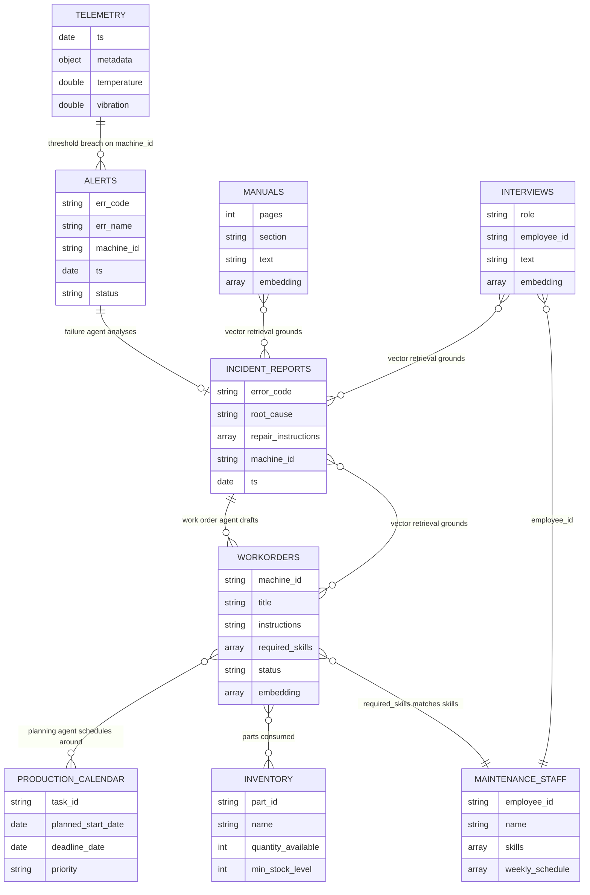

# EDD — Entity Document Diagram

MongoDB data model for the Agentic Predictive Maintenance demo.

Database: `agentic_predictive_maintenance` (configurable via `DATABASE_NAME`)

Field types below were derived from the seeded documents and the runtime writes,
not from a formal schema — this application defines no JSON Schema validators.

---

## Entity overview

| Collection | Written by | Read by | Vector index |
| --- | --- | --- | --- |
| `telemetry` | Simulator + `seed:context` (time series) | Failure agent, telemetry chart, Connected Factory Context Explorer | — |
| `alerts` | Simulator threshold check + `seed:context` | Failure agent, Alerts list, Connected Factory Context Explorer | — |
| `incident_reports` | Failure agent | Work order agent, UI | — |
| `workorders` | Work order agent + seed + `seed:context` | Planning agent, vector retrieval, Connected Factory Context Explorer | `default` |
| `manuals` | Seed | Failure agent (vector retrieval) | `default` |
| `interviews` | Seed | Failure agent (vector retrieval) | `default` |
| `inventory` | Seed | Work order agent | — |
| `maintenance_staff` | Seed | Planning agent | — |
| `production_calendar` | `generate_calendar` / release sync | Planning agent | — |
| `argument_records` | Contestable AI agents + Engineer | Contestable AI scoring & UI | — |
| `contestable_sessions` | Contestable AI API | Contestable AI UI, `$lookup` audit lineage | — |
| `materials` | Auto-init / `seed:context` | Connected Factory Context Explorer (`$lookup` limits) | — |
| `excursions` | Auto-init / `seed:context` | Connected Factory Context Explorer (`$vectorSearch`) | `excursion_signature_index` |
| `checkpoints`, `checkpoint_writes` | LangGraph checkpointer | LangGraph | — |

---

## `telemetry`

Time series collection (`timeField: ts`, `metaField: metadata`, `expireAfterSeconds: 86400` — **documents self-delete after 24 hours**). Shared by the Failure Prediction simulator (`M1` temperature/vibration readings) and Connected Factory Context Explorer (`LTW-04` welding signals synced automatically to the current UTC day so readings stay within the 24-hour TTL window without accumulating).

| Field | Type | Notes |
| --- | --- | --- |
| `_id` | ObjectId | |
| `ts` | date | Time field |
| `metadata` | object | Meta field |
| `metadata.factory_id` | string | e.g. `leafy_factory` |
| `metadata.machine_id` | string | e.g. `M1` \| `LTW-04` |
| `metadata.prod_line_id` | string | e.g. `ev_module_assembly` |
| `metadata.area` | string | Optional (`welding` on `LTW-04`) |
| `metadata.signal` | string | Optional (`weld-zone-temp` \| `laser-power` \| `shield-gas-flow` on `LTW-04`) |
| `metadata.unit` | string | Optional (`degC` \| `W` \| `L/min`) |
| `metadata.workOrder` | string \| null | Optional edge-stamped MES order ID on `LTW-04` |
| `metadata.materialMaster` | string \| null | Optional ERP foil material code on `LTW-04` |
| `temperature` | double | °C (simulator readings on `M1`) |
| `vibration` | double | mm/s (simulator readings on `M1`) |
| `value` | double | Sensor measurement (`LTW-04` multi-signal telemetry) |

Indexes: `metadata_1_ts_1` (implicit), `{ "metadata.machine_id": 1, "metadata.signal": 1, ts: 1 }`, `{ "metadata.materialMaster": 1, ts: 1 }`.

## `alerts`

Shared operational alerts collection. Raised live on `M1` by [src/lib/simulation/failureDetection.js](./src/lib/simulation/failureDetection.js) and synced with 9 `LTW-04` edge-weld-monitor alerts (`ALT-LTW04-01` … `ALT-LTW04-09`) for the active UTC day (deliberately carrying no `workOrder`, `materialMaster`, or `operatorId` for read-time interval `$lookup`).

| Field | Type | Notes |
| --- | --- | --- |
| `_id` | ObjectId | |
| `alert_id` | string | Optional unique ID for `LTW-04` edge alerts (partial unique index) |
| `err_code` | string | `E12` \| `E13` (`M1`) or `W-TEMP-01` etc. (`LTW-04`) |
| `err_name` | string | Human-readable alarm label |
| `machine_id` | string | `M1` \| `LTW-04` |
| `area` | string | Optional (`welding`) |
| `priority` | int | Optional (`1`–`3` on `LTW-04`, `1` = highest) |
| `source` | string | Optional (`edge-weld-monitor`) |
| `details` | object | `temperature` / `vibration` (`M1`) or `component` / `message` (`LTW-04`) |
| `ts` | date | Point-in-time alert timestamp |
| `status` | string | `new` \| `unacknowledged` |

Indexes: `{ machine_id: 1, ts: 1 }`, `{ status: 1, priority: 1, ts: 1 }`, `{ alert_id: 1 }` (partial unique).

## `incident_reports`

Generated by the failure agent from retrieved manuals, work orders, and interviews.

| Field | Type | Notes |
| --- | --- | --- |
| `_id` | ObjectId | |
| `error_code` | string | Mirrors `alerts.err_code` |
| `error_name` | string | Mirrors `alerts.err_name` |
| `root_cause` | string | LLM-generated analysis |
| `repair_instructions` | array\<object\> | Ordered steps |
| `repair_instructions[].step` | int | 1-based |
| `repair_instructions[].description` | string | |
| `machine_id` | string | |
| `contestation` | object | Optional summary written when refined via Contestable AI (`session_id`, `winning_candidate`, `score`, `contested_at`) |
| `ts` | date | |

## `workorders`

Shared collection holding both maintenance work orders (`M1` seeded history + agent-generated orders, embedded for vector retrieval) and MES production order spans (`orderType: "production"` on `LTW-04` for read-time interval `$lookup` in Connected Factory Context Explorer).

| Field | Type | Notes |
| --- | --- | --- |
| `_id` | ObjectId | |
| `machine_id` | string | `M1` \| `LTW-04` |
| `title` | string | Maintenance orders (embedded) |
| `instructions` | string | Maintenance orders (embedded) |
| `estimated_duration` | string | Free text, e.g. `3 hours` — not a number |
| `proposed_start_time` | string | ISO-8601 **string**, not a BSON date |
| `required_skills` | array\<string\> | Matched against `maintenance_staff.skills` |
| `observations` | string | Maintenance orders (embedded) |
| `root cause` | string | ⚠️ Field name contains a space — see Known inconsistencies |
| `status` | string | e.g. `completed` |
| `created_at` | object \| date | ⚠️ Seeded maintenance docs store `{ $date: … }` |
| `embedding` | array\<double\> | 1024 dims (maintenance orders only) |
| `workOrder` | string | Production order ID (`WO-1001232` … `WO-1001236`, partial unique index, updated in-place for active UTC day) |
| `orderType` | string | `production` on `LTW-04` production order spans |
| `startedAt` | date | Inclusive start of `LTW-04` production order window |
| `endedAt` | date | Exclusive end of `LTW-04` production order window |
| `materialMaster` | string | Logical ref to `materials.materialMaster` |
| `product` | string | `EV-PM-4C-S` \| `EV-PM-4C-P` \| `EV-PK-8M-LR` |
| `plannedQty` | int | |
| `operatorId` | string | |

Indexes: `{ machine_id: 1, startedAt: 1 }`, `{ workOrder: 1 }` (partial unique). Vector index `default`: `embedding`, cosine, 1024 dimensions.

## `manuals`

| Field | Type | Notes |
| --- | --- | --- |
| `_id` | ObjectId | |
| `pages` | int | |
| `section` | string | Embedded |
| `text` | string | Embedded |
| `embedding` | array\<double\> | 1024 dims |

Vector index `default`: `embedding`, cosine, 1024 dimensions.

## `interviews`

Technician interview transcripts — the tacit-knowledge source for root-cause analysis.

| Field | Type | Notes |
| --- | --- | --- |
| `_id` | ObjectId | |
| `role` | string | e.g. `Senior Technician` |
| `employee_id` | string | Logical ref to `maintenance_staff.employee_id` |
| `creation_date` | object | ⚠️ Stored as `{ $date: … }`, not a BSON date |
| `type` | string | e.g. `maintenance` |
| `text` | string | Embedded |
| `embedding` | array\<double\> | 1024 dims |

Vector index `default`: `embedding`, cosine, 1024 dimensions.

## `inventory`

| Field | Type | Notes |
| --- | --- | --- |
| `_id` | ObjectId | |
| `part_id` | string | e.g. `P-001` |
| `name` | string | |
| `description` | string | |
| `quantity_available` | int | |
| `min_stock_level` | int | Reorder threshold |
| `lead_time_days` | int | |
| `location` | string | |
| `unit_cost` | double | |
| `last_updated` | object | ⚠️ Stored as `{ $date: … }`, not a BSON date |

## `maintenance_staff`

| Field | Type | Notes |
| --- | --- | --- |
| `_id` | ObjectId | |
| `employee_id` | string | e.g. `EMP-1001` |
| `name` | string | |
| `role` | string | |
| `skills` | array\<string\> | Matched against `workorders.required_skills` |
| `weekly_schedule` | array\<object\> | Per-day availability |
| `weekly_schedule[].day` | string | |
| `weekly_schedule[].full_day` | bool | |
| `weekly_schedule[].coverage` | string | |
| `weekly_schedule[].shifts` | array\<object\> | Shift windows |

## `production_calendar`

Regenerated wholesale by `npm run generate_calendar <months>` (and once per new staging/production deployment when `DEPLOYMENT_ID` is set).

| Field | Type | Notes |
| --- | --- | --- |
| `_id` | ObjectId | |
| `task_id` | string | e.g. `PROD-0121` |
| `task_type` | string | e.g. `production` |
| `initial_start_date` | date | |
| `planned_start_date` | date | Shifted when maintenance is scheduled |
| `planned_end_date` | date | |
| `deadline_date` | date | |
| `duration` | int | Days |
| `delay_factor` | double | |
| `priority` | string | `high` \| … |
| `pieces_to_produce` | int | |
| `deployment_id` | string | Optional; release tag stamped on managed deployments so pod restarts do not regenerate |

## `checkpoints` / `checkpoint_writes`

Managed by `@langchain/langgraph-checkpoint-mongodb`. Treat as opaque —
do not hand-edit. Keyed by `thread_id` / `checkpoint_id`, payloads are BSON `Binary`.

## `argument_records`

Individual arguments produced by `vibration_pattern_agent`, `maintenance_history_agent`,
or added/edited by a human reliability engineer during a Contestable AI session.

| Field | Type | Notes |
| --- | --- | --- |
| `_id` | ObjectId | |
| `argument_id` | string | Unique argument identifier within the session |
| `session_id` | string | e.g. `incident-4471` |
| `candidate` | string | `bearing_degradation` \| `misalignment` \| `sensor_fault` |
| `agent` | string | `vibration_pattern_agent` \| `maintenance_history_agent` \| `reliability_engineer` |
| `stance` | string | `support` \| `challenge` |
| `score` | double | Confidence score in `[0, 1]` |
| `reason` | string | Plain-language 1–2 sentence explanation |
| `created_at` | string | ISO-8601 timestamp |
| `status` | string | `active` \| `rejected` |
| `human_action` | string | `accept` \| `reject` \| `modify` \| `add` \| `null` |

## `contestable_sessions`

Governance and audit session document linking candidate root causes, initial and
post-contestation scores, engineer review events, and single-query `$lookup` lineage over `argument_records`.

| Field | Type | Notes |
| --- | --- | --- |
| `_id` | ObjectId | |
| `session_id` | string | Joins with `argument_records.session_id` |
| `machine_id` | string | e.g. `M1` |
| `incident_id` | string | Optional reference to `incident_reports._id` |
| `candidates` | array\<object\> | Fixed 3 root-cause candidates from vector search |
| `scores_before` | object | Candidate scores before human contestation |
| `scores_after` | object | Candidate scores after human contestation |
| `winning_candidate` | string | Highest-scoring candidate ID |
| `review_events` | array\<object\> | Sequenced engineer accept/reject/modify/add actions |
| `resolution` | object | Refined `root_cause`, `repair_instructions`, and `rationale` |
| `status` | string | `in_review` \| `committed` |

## `materials`

ERP tab and busbar material master specifications (3 documents) used by Connected Factory Context Explorer (`/ai-workflows/context-explorer`).

| Field | Type | Notes |
| --- | --- | --- |
| `_id` | ObjectId | |
| `materialMaster` | string | Unique (`MAT-CU-020`, `MAT-AL-030`, `MAT-CU-025`) |
| `name` | string | Foil/strip description |
| `supplier` | string | |
| `thicknessMm` | string | e.g. `0.20` |
| `maxShieldO2Ppm` | int | |
| `maxWeldTempC` | double | Maximum allowable weld-zone temperature (°C) |

Index: `{ materialMaster: 1 }` (unique).

## `excursions`

Historical 4-minute weld-zone temperature excursions across the fleet (24 documents) with z-scored 24-bin curve vectors.

| Field | Type | Notes |
| --- | --- | --- |
| `_id` | ObjectId | |
| `excursionId` | string | Unique (`EX-2026-0001` …) |
| `machine_id` | string | `LTW-02` \| `LTW-03` \| `LTW-04` \| `LTW-06` \| `LTW-09` |
| `site` | string | `leafy-ev-01` \| `leafy-ev-02` \| `leafy-na-01` |
| `laserModel` | string | |
| `signal` | string | `weld-zone-temp` (filter field) |
| `start` | date | Window start |
| `end` | date | Window end (+240s) |
| `workOrder` | string | |
| `materialMaster` | string | Filter field |
| `material` | string | |
| `operatorId` | string | |
| `peakTempC` | double | |
| `rootCause` | string \| null | `null` when `status === "open"` |
| `fix` | string \| null | |
| `status` | string | `closed` \| `open` (filter field) |
| `signature` | array\<double\> | 24-dim z-scored 10-second curve bins |

Indexes: `{ excursionId: 1 }` (unique), `{ machine_id: 1, start: 1 }`.
Vector index `excursion_signature_index`: `signature` (`cosine`, `24` dims) with `filter` fields on `signal`, `status`, and `materialMaster`.

---

## Relationships

All relationships are **logical only** — there are no foreign keys, no schema
validators, and no indexes beyond `_id` and the time series index.

---

## Known inconsistencies

These are present in the current code and data. Documented here so agents model
reality rather than the intended design.

1. **`workorders.root cause` contains a space.** Every other collection uses
   snake_case (`incident_reports.root_cause`). Critically,
   [scripts/config.js](./scripts/config.js) lists `root_cause` in the
   `workorders` `textFields`, so
   [scripts/embed_collections.mjs](./scripts/embed_collections.mjs) resolves
   `doc["root_cause"]` to `undefined` and substitutes `""` — **root-cause text is
   silently excluded from the work order embeddings.**

2. **Extended JSON dates are stored as nested objects.**
   [scripts/seed.mjs](./scripts/seed.mjs) uses `JSON.parse` on `data/*.json`,
   which leaves `{"$date": "…"}` as a plain object instead of converting it to a
   BSON date. This affects `interviews.creation_date`, `inventory.last_updated`,
   and `workorders.created_at`. Date range queries on those fields will not work.
   The API route at [src/app/api/action/[action]/route.js](./src/app/api/action/%5Baction%5D/route.js)
   already uses `EJSON.parse` correctly — the seed script does not.

3. **`workorders.proposed_start_time` and `estimated_duration` are strings**
   (`"2025-04-10T08:00:00.000Z"`, `"3 hours"`), so they cannot be sorted or
   compared as dates/durations without conversion.
